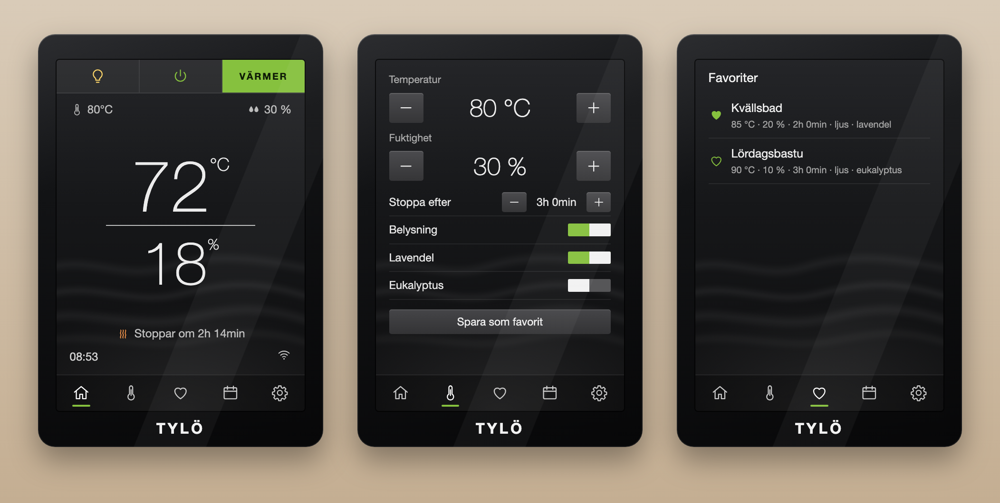

# Tylö Elite Card

A Lovelace card for Home Assistant that looks and works like the Tylö Elite
(Cloud) sauna control panel: the black glass panel, the big thin temperature
with the humidity under a line, −/+ for temperature, humidity and bath time,
toggles for lighting and aroma, favourites, a weekly program and a system
screen, behind the panel's own row of icons.

[![hacs][hacs-badge]][hacs-url]



It is made for the ESPHome
[sauna360 component (f-io/esphome-tylo)](https://github.com/f-io/esphome-tylo),
which talks to Tylö and Helo heaters (Pure, Combi, Elite) over the RS485 bus.
Point the card at that device's climate entity and it finds the rest
by itself. Any other sauna works too: a climate or a switch for the heater, and
the other roles given by hand.

*Not affiliated with, or endorsed by, Tylö or Sauna360. Tylö is their
trademark; the card only imitates the look of the panel.*

## Install

### HACS

1. HACS → ⋮ → **Custom repositories**: add `https://github.com/beolink/tylo-elite-card`,
   type **Dashboard**.
2. Open **Tylö Elite Card** in HACS and **Download**.
3. Reload the browser. HACS adds the resource `/hacsfiles/tylo-elite-card/tylo-elite-card.js`
   by itself.

### By hand

Copy `dist/tylo-elite-card.js` to `/config/www/`, then add the resource
under Settings → Dashboards → ⋮ → Resources: `/local/tylo-elite-card.js`,
type *JavaScript module*.

## Use

The smallest card, for the ESPHome device:

```yaml
type: custom:tylo-elite-card
entity: climate.tylo_sauna_climate
```

The card is also in the card picker ("Tylö Elite"), and it has a visual editor.
Toggles or schedules written with names, and favourites, are edited in YAML.

A fuller one:

```yaml
type: custom:tylo-elite-card
entity: climate.tylo_sauna_climate
name: Bastun
entities:
  humidity: sensor.bastu_luftfuktighet     # a humidity sensor in the sauna
toggles:
  - switch.bastu_doft_lavendel
  - entity: switch.bastu_doft_eukalyptus
    name: Eukalyptus
favorites:
  - name: Kvällsbad
    temperature: 85
    humidity: 20
    bath_time: 120          # minutes
    light: true
    toggles:
      switch.bastu_doft_lavendel: true
schedule:
  - schedule.bastu_helg
  - automation.bastu_fredag_kvall
```

A sauna without ESPHome: a switch, a sensor and helpers:

```yaml
type: custom:tylo-elite-card
entity: switch.bastuaggregat
entities:
  temperature: sensor.bastu_temperatur
  target_temperature: input_number.bastu_maltemperatur
  bath_time: input_number.bastu_badtid      # min, h or s: the unit is read
  remaining_time: timer.bastu               # a sensor in minutes works too
  light: light.bastu_tak
```

### Options

| Option | Default | |
|---|---|---|
| `entity` | *required* | The heater: a `climate` (on/off is its HVAC mode) or a `switch`/`input_boolean` |
| `name` | | Written on the glass over the screen |
| `entities` | found | The roles below, by entity id; `none` drops a role that was found |
| `toggles` | | More rows under Lighting on the settings screen: ids, or `{entity, name}` |
| `favorites` | | Fixed favourites: `name`, and any of `temperature`, `humidity`, `bath_time` (min), `light`, `toggles` (`{entity_id: true/false}`) |
| `schedule` | | The calendar screen: `schedule`, `calendar`, `automation`, `input_boolean` or `switch` entities |
| `info` | | More rows on the system screen |
| `time_step` | `10` | Minutes per press on *Stop after* |
| `language` | user's | `sv`, `en` or `de`; any other language gets English |
| `hide_bezel` | `false` | `true`: the screen alone, without the black glass frame |
| `logo` | `TYLÖ` | The word on the frame; `none` hides it |
| `max_width` | `380px` | The panel's largest width |

### Roles

| Role | Domain | ESPHome sauna360 | |
|---|---|---|---|
| `heater` | switch | `switch.<dev>_heater` | On/off, when `entity` is a climate and you want the switch instead |
| `temperature` | sensor | `sensor.<dev>_current_temperature` | The big figure. A climate's own `current_temperature` otherwise |
| `target_temperature` | number, input_number | `number.<dev>_bath_temperature` | − and +. A climate's own target otherwise |
| `humidity` | sensor | | The big figure under the line |
| `target_humidity` | number, input_number | `number.<dev>_humidity` (Combi Elite) | − and + |
| `bath_time` | number, input_number | `number.<dev>_bath_time` | *Stop after* |
| `remaining_time` | sensor, timer | `sensor.<dev>_remaining_time` | "Stops in …" on the home screen |
| `light` | switch, light, input_boolean | `switch.<dev>_light` | The bulb in the top bar and the *Lighting* row |
| `ready` | binary_sensor | `binary_sensor.<dev>_ready_state` | READY instead of HEATING. Without it: within 2 °C (4 °F) of the target |
| `heating` | binary_sensor | `binary_sensor.<dev>_heater_state` | The heat waves while the element is on |

With a climate as `entity`, every role is looked up among the entities on the same
device, by the object id without the prefix the device's entities share
(`tylo_bath_time` → `bath_time`). The system screen lists the device's
diagnostic sensors in the same way: heating element, water tank, uptime, Wi-Fi.

## How it behaves

- **Home**: the bath temperature in large type, the humidity under a line, the
  set values small at the top, the clock (Home Assistant's time zone) and the
  connection at the bottom. The top bar holds lighting, power and the state:
  OFF, HEATING (pulsing green) or READY. Tap the figures for the settings;
  tap the Wi-Fi mark for the heater's more-info dialog.
- **− and +** show the new value at once. The value is sent 0.7 s after the last
  press, so ten presses are one write. Holding a button repeats it.
- **Favourites**: *Save as favourite* stores the screen's values in your own Home
  Assistant profile (`frontend/set_user_data`), so they follow you to every
  device. Tap a favourite, then **Start**: it sets the values and turns the
  heater on. Favourites from the configuration are shared by everyone and
  cannot be deleted from the card.
- **Unavailable**: the Wi-Fi mark turns red and crossed out, and the controls
  are locked.
- Toggles and power show their new state at once and fall back if Home
  Assistant does not confirm within five seconds. A failed call shows Home
  Assistant's own error toast.

## Development

No build step: `dist/tylo-elite-card.js` is the source.

```bash
npm test          # node --test, the pure helpers
npm run demo      # then open http://127.0.0.1:8765/demo/ — a simulated sauna
```

`demo/?shot` renders the picture above.

## License

Apache 2.0

[hacs-badge]: https://img.shields.io/badge/HACS-Custom-41BDF5.svg
[hacs-url]: https://github.com/hacs/integration
